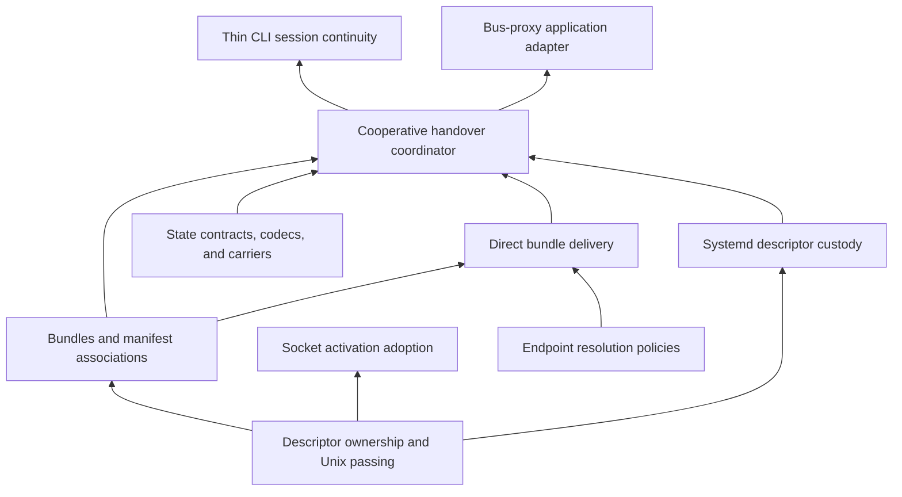

# Handle-off

**Tools for passing, retaining, and recovering access to open resources, together
with the information needed to continue using them.** Stdio is one bundle;
established network connections are another. Direct handoff, systemd fdstore,
and socket activation are independently useful capabilities in the toolkit.

This is a fresh design. The existing clid workspace and deployed bus-proxy are
evidence and potential implementation sources, not compatibility constraints.
The project name and direction reflect human decisions in the source session;
crate names, interfaces, and ticket boundaries below are proposals. No tracker
entries were created by the initial draft. The operator subsequently authorized
implementation and materialization; see [the active work map](work.md).

## Direction and proving applications

The operator selected heavy decomposition, very small consumers, optional remote
support, multiple handover paths, independently usable socket activation, and
**cooperative state-carrying handover** as the initial continuity contract.

Two applications should keep the toolkit honest:

1. **Thin CLI:** forwards invocation and stdio to a warm server, waits for its
   result, and remains connected while that server cooperatively replaces itself.
   Server-owned parsing includes help; the client need not know its commands.
2. **Bus-proxy:** becomes a consumer/sample application, using handle-off beneath
   its existing upstream/downstream SSE continuity machinery. Its protocol state
   and routing policy remain application-owned.

Additional examples exercise ordinary files, pipes, and multiple independent
bundles so that SSE and command invocation do not become universal requirements.
Linux is the initial systemd/memfd integration target; portable Unix mechanisms
should remain separately buildable. No mandatory async runtime.

## Vocabulary and ownership

| Term | Meaning in this proposal |
| --- | --- |
| Resource | An open socket, pipe, terminal, file, or other OS-supported object. |
| Handle | An application-facing reference granting access to a resource. Initially backed by Unix descriptors; not automatically a durable identity. |
| File descriptor | A process-local reference represented by a number; owned/borrowed Rust FD types express its local lifetime. |
| Open file description | Shared kernel open-instance state referenced by duplicated/passed FDs; includes offsets and file status flags. |
| Member | A named role within a bundle, associated with a handle or state payload. |
| Bundle | Related handles and descriptive metadata treated as a recoverable unit. |
| Manifest | Descriptive data associating bundle/member identities, claims, and application extensions with transferred handles. |
| State image | Application/framework state captured at an agreed cut; carried inline or through one or more resources. |
| Generation | Identity for one prepared handover, distinguishing it from older or incomplete deliveries. |
| Custody | Keeping resource references alive, distinct from permission to resume application I/O. |
| Adoption | Validating and taking ownership of received or inherited descriptors. |

Passing an FD creates another reference; it does not revoke the sender's access.
Bundle/member IDs carry logical identity, not raw FD numbers. Two members may
refer to the same underlying open file description. Descriptor flags such as
CLOEXEC differ from shared flags such as O_NONBLOCK; adapters document changes.

The OS may keep a connection alive while its application owner is absent.
Continuing the protocol also needs unread userspace bytes, pending writes and
offsets, decoder state, and relevant application state. Handle-off supplies
mechanisms and coordination; the application defines a sufficient capture.

## Capability layers

These layers compose without requiring every lower-level user to adopt the whole
stack. In particular, activation and raw descriptor passing need no manifest.

### Proposed crate families

Each crate has one independently testable responsibility. Names use the
`handle-off-` prefix provisionally. Domain directories group the workspace;
crate package names need not mirror every directory component.

| Domain / crate suffix | Responsibility and dependency boundary |
| --- | --- |
| `handles` | Handle inspection/claims and borrowed/owned bundles of OS references; use standard FD types rather than inventing duplicate ownership machinery. No codec/runtime. |
| `bundle` | Bundle/member/generation identities and manifest relationships. No systemd, socket, or application invocation knowledge. |
| `state` | State format/version identity and opaque application extension associations. No required serialization framework or persistence engine. |
| `state-rkyv` | Concrete encoding of proposed manifests/images with validation and format compatibility. Optional. |
| `state-memfd` | Linux state-image carrier: create, size-limit, seal, read/map. Receives bytes independently of their encoding. |
| `unix-rights` | Blocking ancillary-data send/receive, truncation handling, descriptor ownership and cleanup. No bundle schema. |
| `activation` | Capture activation descriptors/names, validate process ownership, and adopt safely. Independently usable; no fdstore required. |
| `systemd-notify` | Small notification/ancillary-message and barrier mechanics shared by manager adapters. No async runtime. |
| `systemd-fdstore` | Store/remove operations, capacity/capability reporting, and explicit acceptance-verification integration. Depends on notify mechanics, not application state. |
| `rendezvous` | Endpoint-resolution interface/data; no connection establishment or server launch. |
| `rendezvous-local` | Sample explicit/env/local/XDG policy. Application supplies namespace/names. |
| `transport-unix` | Sample direct bundle protocol: framing, descriptor/manifest association, acknowledgment and completion of delivery. Composes rights and selected encoding. |
| `handover` | Prepare/park/capture/deliver/commit/adopt/resume lifecycle and application/backend hooks. Runtime-independent. |
| `handover-systemd` | Bundle naming/recovery and verified generation lifecycle over activation + fdstore + selected state carrier. |
| `stdio` | Stdin/stdout/stderr role convention and convenient borrowed/owned access. Useful without handoff. |
| `invocation` | Command, byte-preserving Unix arguments/environment/cwd representation. Independent of remote execution. |
| `session` | Invocation/result/completion-channel convention and optional session handover integration. No command registry or executor requirement. |
| `handle-off` (facade) | Opt-in reexports and feature groups; defaults expose only lightweight local vocabulary/helpers. |

The sample direct transport and rkyv encoding are real replaceable implementation
crates, not code hidden inside a demonstration binary. Do not invent a universal
transport trait that requires Varlink to pretend to be this sample protocol.
Shared interfaces describe bundle delivery/custody outcomes and lifecycle needs.

The `handles`, `bundle`, and `state` seams need a first executable spike: avoid
cyclic dependencies by keeping opaque extension references with bundle metadata,
and implementing codecs/carriers downstream. A small contract crate is justified
by actual shared types, not by the desire to force every table row into existence.

### Small-build contract

Local consumers can use stdio/invocation helpers without sockets, systemd, memfd,
rkyv, or Tokio. A consumer feature enables its chosen remote backend and all its
optional dependencies. Merely disabling runtime use is insufficient. The facade
offers explicit opt-ins; no broad defaults that accidentally pull the stack in.

A blocking CLI sends descriptors/arguments and waits for completion. Async is an
application integration choice. Bus-proxy may adapt these mechanisms to its own
runtime. Measure dependency trees and stripped binary sizes for both local and
remote builds before selecting optimization work; specify no unsupported size
number in advance.

## Bundle metadata and pluggable state

Separate **meaning**, **encoding**, and **carrier**:

- Framework metadata identifies generation, bundle/member roles, descriptor
  claims, state format, and declared compatibility requirements.
- Application extensions carry opaque versioned state per member, per bundle,
  or across bundles. The application validates meaning and decides compatibility.
- A codec encodes that information; rkyv is an initial implementation.
- A carrier moves bytes inline, in a sealed memfd, or in another selected
  resource. A bundle may reference multiple state carriers.

An image's role can be discovered without first decoding every application
payload. In systemd, a constrained generation/bundle/member naming convention
locates manifests and members through LISTEN_FDNAMES; manifests provide the
richer associations. FDNAME is not inherently unique and replay order is not
identity. Reject ambiguous/missing required members explicitly. Name length,
encoding, duplicate references, and compatibility rules need specification.

Memfds enter fdstore exactly as other FDs do. Distinct names require distinct
store submissions. Multi-entry publication is not atomic: manifest-last is useful
but is not sufficient proof of completeness or acceptance. Validate the full
generation against its manifest and the selected backend's verified delivery.

State pluggability initially means explicit byte/handle extension points and
application capture/restore hooks. It does not require adopting a reactive state
framework or promising restoration of arbitrary process memory.

## Cooperative continuity contract

1. **Prepare:** check successor/application compatibility and custody capacity.
2. **Park:** application stops conflicting admission and I/O at its chosen cut.
3. **Capture:** application provides handles plus exact sufficient protocol/state
   images; identities and relationships form the prepared generation.
4. **Deliver and verify:** direct successor or manager takes custody. Report what
   was actually verified; sd_notify send success and a barrier alone do not prove
   fdstore acceptance.
5. **Commit:** relinquish the old application owner's right to resume. Process
   replacement/exit policy remains an integration choice, not a magic core status.
6. **Adopt:** successor validates complete membership, images, and compatibility;
   explicitly retires transient manager custody where required before resumed I/O.
7. **Resume:** reconstruct application owners and continue using the same resources.

Before commit, abort may resume the old owner only after resolving any delivered
copies so two application owners cannot operate concurrently. After commit,
failure is an adoption failure, not an automatic invitation for the old process
to resume. Define each backend's commit point and failure states explicitly.

Cleanup is explicit lifecycle work on the owned generation, not automatic pruning
of unrecognized fdstore entries. Persistent listener custody and transient session
custody have different lifetimes; callers must be able to select them.

Socket activation creates/retains endpoints and launches a service; fdstore
retains resources a service supplies. Shared activation parsing does not make
their lifecycle policies identical. Test their composition deliberately: deployed
bus-proxy's first cooperative implementation requires a self-bound retained
listener and does not yet support the socket-unit-only configuration.

Initial continuity covers prepared cooperative cuts. Arbitrary crash recovery,
exactly-once execution, TLS state extraction, and process checkpointing are not
implied. Future constrained recovery might use a surviving I/O owner or explicit
application checkpoints; it does not necessarily require CRIU, but is separate
work and has no implementation epic in this initial plan.

## Bus-proxy as consumer and source of evidence

The useful source is **`/usr/local/src/opencode-bus-proxy-git/repo`**, not only
the public/dev checkout. [The recovery report](research1.glm53max.md) identifies
commits and recorded tests/live evidence. Its implementation uses a sealed
JSON/base64 memfd envelope; rkyv is adjacent optional research, not its required
handover codec. Handle-off should not accidentally couple bus-proxy migration to
a codec rewrite.

Reuse/generalize descriptor naming, image custody, verified storage, activation
adoption, and handover coordination. Keep HTTP/SSE framing, writer offsets,
subscription state, routing, and supported-connection selection in bus-proxy.
Retain buffered/boundary behavior and its evidence while replacing machinery.

Use an external consumer integration/sample first, preserving the deployment
line's provenance. Upstreaming its unpushed history and choosing its development
home are separate repository decisions, not implicit effects of this draft.

## Draft epic and ticket map

IDs below are planning aliases, not created beads IDs. On materialization, inspect
the native tracker prefix and existing work, choose readable IDs, add parent-child
edges, and translate prerequisites into dependent-first blocking edges. Existing
experiments are evidence, not tickets presumed complete in the new toolkit.

### E1 — Contracts and small-build foundation

**Outcome:** independently usable vocabulary and demonstrated dependency boundaries.

| Ticket | Scope / acceptance | Prerequisites |
| --- | --- | --- |
| E1.1 Inventory and extraction map | Map existing clid and deployed bus-proxy mechanisms to proposed owners; identify protocol-specific code and retained evidence. | — |
| E1.2 Handle/bundle/state contracts | Executable API spike with two named bundles, optional per-member/bundle extensions, shared-resource aliases, and explicit ownership. Publish proposed manifest/version rules. | E1.1 |
| E1.3 Workspace and facade feature graph | Domain-grouped crates; local-only and chosen remote sample compile separately; dependency inspection proves runtime/codec/manager exclusion from local build. Record binary-size method and baseline. | E1.2 |

### E2 — Descriptor transport and direct bundle delivery

**Outcome:** runtime-free direct transfer with observable ownership and completion.

| Ticket | Scope / acceptance | Prerequisites |
| --- | --- | --- |
| E2.1 Unix rights primitive | Blocking send/receive with explicit ownership/CLOEXEC policy; real pipe/socket transfers; malformed/truncated ancillary data closes all acquired FDs. | E1.2 |
| E2.2 Rkyv image and memfd carrier | Separately usable codec and carrier; version/size validation and sealed-image round trip; multiple state images associated with members. | E1.2 |
| E2.3 Sample direct protocol | Select/document initial socket type; exact metadata/FD association, limits, delivery acknowledgment, disconnect semantics; reordered/missing membership and partial-delivery cases tested. | E2.1, E2.2 |
| E2.4 Sample rendezvous policy | Explicit/env/local/XDG resolver with caller-owned names; connected-endpoint injection bypasses resolution; discovery never silently starts a server. | E2.3 |

### E3 — Activation and systemd custody

**Outcome:** independently useful activation and fdstore tools, plus named bundle recovery.

| Ticket | Scope / acceptance | Prerequisites |
| --- | --- | --- |
| E3.1 Activation adoption | Multi-FD/name capture, PID validation, ownership and CLOEXEC handling; independent example accepts a socket-unit listener without bundle/state dependencies. | E1.2 |
| E3.2 Notify/fdstore primitives | Store/remove/barrier operations; fake-manager checks; capacity and unsupported verification surfaced explicitly. Isolate any D-Bus/busctl dependency from notification-only builds. | E2.1 |
| E3.3 Named generation adapter | Names locate multiple bundles/images independent of order; complete-generation validation; explicit acceptance verification and retirement of owned transient entries. | E2.2, E3.1, E3.2 |
| E3.4 Real-manager conformance | Isolated service tests distinguish listener/session retention, verify same live resources across replacement, and cover capacity/partial-store failures plus activation composition. Record supported manager capabilities/versions. | E3.3 |

### E4 — Cooperative handover lifecycle

**Outcome:** application/backend hooks with a comprehensible single-owner commit contract.

| Ticket | Scope / acceptance | Prerequisites |
| --- | --- | --- |
| E4.1 Prepared generation and abort | Define lifecycle states, application park/capture/restore hooks, backend verification outcome, and ownership of rollback. Fault tests prove no concurrent resumed owners. | E1.2, E2.3 |
| E4.2 Direct successor integration | Two processes transfer multiple resource bundles and state; successor continues pending I/O; before/after-commit failures have explicit outcomes. | E4.1 |
| E4.3 Systemd replacement integration | Same application hooks with fdstore custody; successor compatibility checks and explicit transient retirement; persistent listener remains retained. | E4.1, E3.4 |

### E5 — Thin CLI and restart-surviving sessions

**Outcome:** original purpose fulfilled with a small synchronous client.

| Ticket | Scope / acceptance | Prerequisites |
| --- | --- | --- |
| E5.1 Local invocation and stdio | Application handler uses explicit stdio/cwd/env; non-UTF-8 Unix values preserved; local-only example has no remote dependencies. | E1.3 |
| E5.2 Blocking proxy and result | Forward argv including help; server parses; transferred stdin/out/err work through pipes/redirection; client exits with result; define signal/disconnect scope without claiming full shell job-control transparency. | E5.1, E2.3 |
| E5.3 CLI session survives replacement | Capture invocation, stdio, completion channel and demo handler state; client remains waiting across direct and systemd replacements; verify exact output and final result. | E5.2, E4.2, E4.3 |

### E6 — Bus-proxy adoption and generality

**Outcome:** deployed handover mechanisms have a reusable home and an independent real consumer.

| Ticket | Scope / acceptance | Prerequisites |
| --- | --- | --- |
| E6.1 Consumer seam prototype | Integrate against deployment continuation; separate SSE capture/restore from toolkit custody and images; preserve existing codec initially. Review generic contract against actual buffered/boundary needs. | E1.1, E4.1 |
| E6.2 Replace reusable machinery | Adopt toolkit activation/fdstore/generation coordination; retain existing application format and semantics unless deliberately changed. Existing handover suites establish retained behavior. | E6.1, E4.3 |
| E6.3 Consumer demonstration | Controlled upstream plus multiple downstream connections survive replacement; IDs, byte offsets and connection identity retained. Publish reproducible sample/integration instructions. | E6.2 |
| E6.4 Non-CLI/non-SSE bundles | File/pipe/resource example proves independent bundles and state extensions without command/session crates. | E4.2 |

### Future epics with basic tickets

| Epic | Draft tickets and scope |
| --- | --- |
| E7 Varlink integration | E7.1 inspect current Varlink implementations and FD-transfer extensions before choosing composition; E7.2 primary Varlink adapter using either native supported mechanisms or an explicitly associated FD channel; E7.3 interoperability example. Do not assume codec/transport traits from the sample Unix protocol fit. |
| E8 Shell completion and introspection | E8.1 thin-client shell completion support with server-owned command knowledge; E8.2 optional structured argument/help/capability discovery; E8.3 disconnected/completion failure behavior. Baseline `--help` remains ordinary argv forwarding. |
| E9 One-off server mode | E9.1 opt-in short-lived server when rendezvous finds none; E9.2 startup races and child/session lifetime tests. Low priority: record intent, defer launch design. |
| E10 Rich application coordination | E10.1 recover bus-proxy's proposed prepare-handover checkpoint/barrier work; E10.2 application capability/compatibility negotiation; E10.3 optional async adapters justified by consumers, without adding a core runtime dependency. |
| E11 Diagnostics and inspection | E11.1 inspect bundle/member/generation inventory without exposing payloads by default; E11.2 explain incomplete/unsupported adoption; E11.3 optional state export adapters isolated from small builds. |

## Landing sequence and review points

1. Inventory, contract spike, and feature/size baseline (E1); review against both
   bus-proxy's real capture and a simple local CLI before freezing interfaces.
2. Independent Unix/state/activation/notify primitives (E2/E3); direct delivery
   and a basic CLI can become useful before restart coordination is complete.
3. Prepared-generation lifecycle, early bus-proxy seam prototype, and both
   custody paths (E4/E6.1); review single-owner semantics at the commit boundary.
4. Restart-surviving CLI and bus-proxy consumer integration (E5.3/E6); compare
   actual shared mechanisms and accidental application coupling.
5. Select future capabilities by user priorities; retain the basic backlog above.

Implementation was subsequently authorized in the source session. The
[active work map](work.md) records native tickets and the initial dispatch.
Review the contract/crate seams, sample transport, and manifest bootstrap at
coherent implementation checkpoints; future APIs remain open.

## Cross-references and verification

- [Research 1](research1.glm53max.md) supplies the decisive implemented precedent,
  historical/session provenance, and recorded connected-client preservation.
- [Research 0](research0.glm53max.md) supplies descriptor/fdstore background;
  its repository-wide absence claims are corrected by Research 1.
- [Current README](../../README.md) describes the original CLI experiment, which
  this proposal generalizes; it is not yet the handle-off architecture home.
- [Bus-proxy handover contract](file:///usr/local/src/opencode-bus-proxy-git/repo/doc/event-multiplexer/handover.md)
  is the operational evidence for state inventory, current limitations, and
  acceptance verification. It establishes precedent, not implementation here.

Verification for this draft: read the two research reports, the maintained
bus-proxy contract, and original CLI/context/daemon source. No runtime behavior
was changed or re-tested. Crate graph, APIs, and ticket acceptance are proposed
work; live-demonstration claims are attributed to the recovered evidence.
